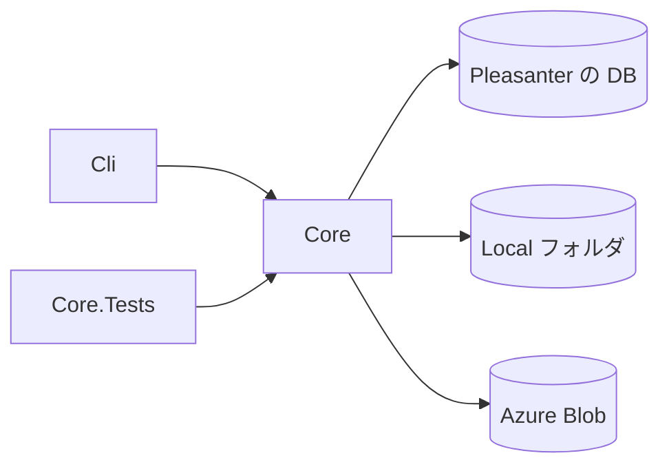

# アーキテクチャ方針

## 位置づけ

Pleasanter に添付されたファイル（`Binaries`）の保管先を、Rds・Local・AzureBlob の間で移すコマンドラインツールです。
Pleasanter 本体のコードは取り込みません。派生著作物にしないことで、ライセンスの選択肢（[ライセンス](ライセンス.md)）を残します。
本体の置き方は、`_reference/Implem.Pleasanter` のソースを**事実確認のために読んだ**うえで、このツールが独自に実装します。

## 対象

| 移行元 | 移行先 |
| --- | --- |
| Rds（`Binaries.Bin`） | Local、AzureBlob |
| Local | AzureBlob |
| AzureBlob | Local |

**Rds への書き戻しは対象外**です。

## Pleasanter の保管の仕組み（事実確認の結果）

根拠は `_reference/Implem.Pleasanter`（固定位置 `Pleasanter_1.5.8.1`）のソース。参照日 2026-10-20。

- 保管先は `App_Data/Parameters/BinaryStorage.json` の `Provider`（`Rds` / `Local` / `AzureBlob`）で**全体に 1 つ**決まる
  （`UseStorageSelect` が真なら、列ごとの `BinaryStorageProvider`。`DefaultBinaryStorageProvider` など）。
  根拠: `Implem.ParameterAccessor/Parts/BinaryStorage.cs`、`Implem.Pleasanter/Models/Binaries/BinaryUtilities.cs` の `BinaryStorageProvider`
- Rds の中身は `Binaries` 表の `Bin`（`Guid`・`BinaryType`・`FileName`・`ContentType`・`Size` ほか）
- Local・AzureBlob のオブジェクト名は添付ファイルが **`Attachments/{Guid}`**。
  根拠: `Implem.Pleasanter/Libraries/DataTypes/Attachment.cs`
- Local は `BinaryStorage.json` の `Path`（無ければ `App_Data/BinaryStorage`）の下、AzureBlob は `AzureBlobStorageAccountUri` と `AzureBlobContainerName` のコンテナ
  （`Libraries/DataSources/BinaryStorages/` の各プロバイダ）

## 構成

- `Core`: 移行の本体。移行元・移行先を差し替えられる抽象（読む側・書く側）と、コピーと整合の確認
- `Cli`: コマンドライン。接続先と移行の向きを受け取り、進み具合を英語で出す（コンソールへ出す文字列は英語）
- `Core.Tests`: 単体テスト。Local は一時フォルダ、Azure Blob と DB は差し替え可能な形でスタブ

## 決めたこと

- **既定では移行元を消さない。** 消すのは明示のオプションのときだけ
- **コピーしたあとに、大きさとハッシュで整合を確かめる。** 確かめられなかったものは失敗として数え、移行元を消さない
- **途中で止めても、やり直せる。** 移行先に同じ大きさ・同じハッシュのものがあればとばす
- **ドライラン**（何をどこへ移すかだけ出す）を持つ
- **Pleasanter 本体の `BinaryStorage.json` は書き換えない。** 移行が済んだあとに、利用者が `Provider` を切り替える
- **依存は寛容ライセンスに限る。** デュアルライセンスを選べる状態を保つため。Azure Blob は Azure SDK（MIT）を使う

## 未決定

- Rds の `Binaries` を、DB へ直接つなぐのか、Pleasanter の API 経由にするのか（API にはファイルの本体を取る口が無い見込みで、直接つなぐ想定。確認が要る）
- 画像・サムネイル（`Images` など）や、`Binaries` の `BinaryType` ごとの保管先の扱い
- 履歴（`Binaries` の過去の版）に紐づくファイルの扱い
- 実機の Pleasanter・Azure Blob に対する動作確認は行っていない
