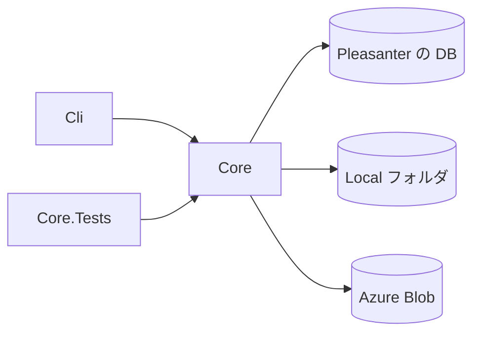

# アーキテクチャ方針

## 位置づけ

Pleasanter に添付されたファイル（`Binaries`）の保管先を、Rds・Local・AzureBlob の間で移すコマンドラインツールです。
Pleasanter 本体のコードは取り込みません。派生著作物にしないことで、ライセンスの選択肢（[ライセンス](ライセンス.md)）を残します。
本体の置き方は、`_reference/Implem.Pleasanter` のソースを**事実確認のために読んだ**うえで、このツールが独自に実装します
（コード・構造はコピーしていません。`scripts/reference-isolation-check.sh` が、ビルド対象から参照ソースへの参照が無いことを検査します）。

## 対象

| 移行元 | 移行先 |
| --- | --- |
| Rds（`Binaries` 表の `Bin` など） | Local、AzureBlob |
| Local | AzureBlob |
| AzureBlob | Local |

**Rds への書き戻しは対象外**です（4 方向: Rds→Local、Rds→AzureBlob、Local→AzureBlob、AzureBlob→Local）。

## 事実確認の結果

根拠は `_reference/Implem.Pleasanter`（固定位置 `Pleasanter_1.5.8.1`、コミット `626a173ec82e32f7055f3e76970a145b79c2296f`）のソース。
参照日 2026-10-20。パスは参照ソースのルートからの相対で、`Implem.Pleasanter/` の下は本体プロジェクトです。
**実機の Pleasanter・DB・Azure では確かめていません**（読んだのはソースだけ）。

### 1. `Binaries` 表の列と `BinaryType`、保管先

出典: `Implem.Pleasanter/App_Data/Definitions/Definition_Column/Binaries_*.json`、`Implem.Pleasanter/Libraries/DataSources/Rds.cs`（`Binaries` の列の一覧と SQL）。

- 列: `BinaryId`（bigint、主キー、自動採番）、`TenantId`、`ReferenceId`、`Guid`（nvarchar(32)）、`Ver`、`BinaryType`（nvarchar(32)）、`Title`、`Body`、
  **`Bin`**（image 型）、**`Thumbnail`**（image 型）、**`Icon`**（image 型）、`FileName`、`Extension`、`Size`（bigint）、`ContentType`、`BinarySettings`、`Comments`、
  `Creator`、`Updator`、`CreatedTime`、`UpdatedTime`
- `image` 型は DBMS ごとに、PostgreSQL が `bytea`、MySQL が `longblob`（出典: `Rds/Implem.PostgreSql/PostgreSqlDataTypes.cs`、`Rds/Implem.MySql/MySqlDataTypes.cs`）。
  SQL Server は型名の置き換えが無く `image` のまま（SQL の中で `varbinary(max)` へ cast している箇所がある。出典: `Rds/Implem.SqlServer/SqlServerSqls.cs`）。
  長さは `DATALENGTH`・`octet_length`・`LENGTH` で取る
- `Guid` は 32 桁の 16 進の大文字（ハイフンなし）。出典: `Implem.Libraries/Utilities/Strings.cs` の `NewGuid()`
- `BinaryType` に使われている値（コードを検索して列挙した。列挙型の定義は無く、文字列で書かれている）:

| BinaryType | 書く処理 | Rds（`Bin` など） | 外部ストレージ（Local・AzureBlob）のオブジェクト名 |
| --- | --- | --- | --- |
| `Attachments` | `Libraries/DataTypes/Attachment.cs` | `Bin` | `Attachments/{Guid}`（このときの `Bin` は NULL） |
| `Images` | `Models/Binaries/BinaryUtilities.cs` の `UploadImage` | `Bin`（外部のときは NULL）。`Thumbnail` は外部でも常に Rds に残る | `Images/{Guid}`、`Images/{Guid}_thumbnail` |
| `TenantManagementImages` | 同上（テナント管理の画面から上げた画像） | `Images` と同じ | 読み出しで `Images` として扱われる（`Libraries/Responses/FileContentResults.cs` の `Bytes`）。名前は `Images/{Guid}` |
| `SiteImage` | `Models/Binaries/BinaryModel.cs` の `UpdateSiteImage` | サイトごとに 1 行。`Bin`＝標準、`Thumbnail`＝サムネイル、`Icon`＝アイコン | `SiteImage/{サイトID}_Regular.png`、`_Thumbnail.png`、`_Icon.png`（**外部のときは `Binaries` の行を作らない**） |
| `TenantImage` | 同 `UpdateTenantImage` | テナントごとに 1 行。`Bin`＝ロゴ | `TenantImage/{ReferenceId}_Logo.png`（**外部のときは行を作らない**） |
| `ExportData` | `Models/Issues/IssueUtilities.cs`、`Models/Results/ResultUtilities.cs` | `Bin`（保管先の指定に関係なく常に Rds） | 置かれない |
| `Temporary` | `Models/Binaries/BinaryUtilities.cs`（`TemporaryBinaryStorageProvider` が `Rds` のときの一時保存） | `Bin` | 置かれない（保存時に `Attachments/{Guid}` へ移される。`Attachment.cs` の `MoveBinFromRdsToExternal`） |

- 外部ストレージのオブジェクト名の根拠: `Attachment.cs`（`$"Attachments/{Guid}"`）、`BinaryUtilities.cs`（`$"Images/{file.Guid}"`、`$"Images/{file.Guid}_thumbnail"`）、
  `Libraries/Images/ImageData.cs`（`ObjectName`: `$"{type}/{referenceId}_{sizeType}.png"`。`type` は `SiteImage` または `TenantImage`、`sizeType` は `Regular`・`Thumbnail`・`Icon`・`Logo`）
- どの種別が外部ストレージに置かれ得るか:
  - **`Attachments`**: `BinaryUtilities.BinaryStorageProvider(column, size)`。`BinaryStorage.json` の `Provider` が外部なら外部。
    `UseStorageSelect` が真なら列ごとの `BinaryStorageProvider`（無ければ `DefaultBinaryStorageProvider`）。`AutoDataBaseOrLocalFolder` なら、列の `LimitSize` を超えるものだけ外部
  - **`Images`・`TenantManagementImages`**: `Parameters.BinaryStorage.GetImagesProvider()`（`ImagesProvider`、無ければ `Provider`）が外部なら外部
  - **`SiteImage`**: `GetSiteImageProvider()`（`SiteImageProvider`、無ければ `Provider`）が外部なら外部
  - **`TenantImage`**: `Parameters.BinaryStorage.Provider` が外部なら外部
  - `ExportData`・`Temporary` は外部に置かれない
- 外部ストレージのプロバイダ名（`Implem.ParameterAccessor/Parts/BinaryStorageProviderNames.cs`）: `Rds`、`Local`、`AzureBlob`。
  内部の別名として `DataBase`（＝Rds）、`LocalFolder`（＝Local）、`AutoDataBaseOrLocalFolder`。
  `BinaryStorageProviderFactory.Create`（`Libraries/DataSources/BinaryStorages/BinaryStorageProviderFactory.cs`）は `Local` と `LocalFolder` を同じ実装、`AzureBlob` を Azure の実装にし、それ以外は null（＝Rds）
- 保管先の設定は `Implem.Pleasanter/App_Data/Parameters/BinaryStorage.json`（既定の `Provider` は `Rds`）。クラスは `Implem.ParameterAccessor/Parts/BinaryStorage.cs`

### 2. Local のルートと、オブジェクト名からパスへの写し

出典: `Implem.DefinitionAccessor/Directories.cs` の `BinaryStorage()`、`Libraries/DataSources/BinaryStorages/LocalFolderBinaryStorageProvider.cs`。

- ルートは `BinaryStorage.json` の `Path`。空なら、本体の実行ディレクトリの下の `App_Data/BinaryStorage`
- オブジェクト名の `/` をディレクトリ区切りへ置き換えて、ルートの下へ連結する（`Attachments/{Guid}` → `{ルート}/Attachments/{Guid}`）。ファイル名に拡張子は付かない
- 次の名前は拒む: 空、絶対パス（`Path.IsPathRooted`）、ドライブ名つき、`\\` または `//` で始まる UNC、**`..` を含むもの**（パストラバーサルの禁止）
- アップロードは `FileMode.Create`（同名があれば置き換え）。ディレクトリは無ければ作る
- このツールの対応: 同じ規則を自前で実装し（`ObjectNames.FindProblem`、`LocalBinaryStore.ResolvePath`）、さらにセグメントの空・`.`・末尾のドットや空白・`:`・`\`・制御文字・
  Windows の予約名・ルートの外へ解決される名前を拒む。書き込みは一時ファイル（`.migrating.tmp`）へ書いてから置き換える

### 3. AzureBlob の接続・認証・コンテンツタイプ

出典: `Libraries/DataSources/BinaryStorages/AzureBlobBinaryStorageProvider.cs`、`Implem.DefinitionAccessor/Initializer.cs`。

- 接続: `BinaryStorage.json` の `AzureBlobStorageAccountUri` と `AzureBlobContainerName`。
  どちらも空なら環境変数 `{環境名}_BinaryStorage_AzureBlobStorageAccountUri`・`..._AzureBlobContainerName`（`{サービス名}_...` も）から補う（`Initializer.cs`）
- 認証: **`Azure.Identity` の `DefaultAzureCredential`**。`new BlobServiceClient(new Uri(アカウントURI), new DefaultAzureCredential(...), options)` から、コンテナーのクライアントを取る。接続文字列での認証は本体には無い
- ブロブ名はオブジェクト名そのもの（`Attachments/{Guid}` など）。コンテナーは本体が作らない（`GetBlobContainerClient` のみ）
- コンテンツタイプ: アップロード時に `BlobHttpHeaders.ContentType` へ、呼び出し側が渡した値（添付なら `Attachment.ContentType`＝`Binaries.ContentType`、画像は `file.ContentType`、サイト画像・テナント画像は `image/png`）
- **ダウンロードの配信に使うコンテンツタイプは、ブロブ側ではなく `Binaries` の行の `ContentType`**（`FileContentResults.Bytes`）。サイト画像・テナント画像は `ImageData` が PNG として扱う
- 本体の読み出しは、ブロブが無いとき（404）に null を返す
- このツールの対応: 接続は `--azure-account-uri`＋`--azure-container`（`DefaultAzureCredential`）。加えて接続文字列（環境変数・ファイル・標準入力）も受ける。
  Local→AzureBlob ではコンテンツタイプが分からないため `application/octet-stream` を付ける（Rds→AzureBlob は `Binaries.ContentType`、サイト画像は `image/png`、AzureBlob→AzureBlob 相当は元のブロブの値）

### 4. 履歴・削除済みの扱いと、行ごとの保管先の判別

出典: `Libraries/Responses/FileContentResults.cs`（`Bytes`、`GetBinariesTable`）、`Libraries/DataTypes/Attachment.cs`（`Exists`、`SqlStatement`）、
`Models/Binaries/BinaryModel.cs`、`Libraries/DataSources/Rds.cs`（`DeleteBinariesStatement`、`RestoreBinariesStatement`）。

- **行ごとの判別は `Bin` が NULL かどうか**だけ。`FileContentResults.Bytes` は、`Bin` が NULL でなければ Rds の値を返し、NULL なら外部ストレージから
  `{BinaryType}/{Guid}` を読む（`TenantManagementImages` は `Images`）。`Attachment.Exists` も `"Bin" is not null` を Rds の存在の条件にしている。
  `BinarySettings` は保管先の判別には使われない（中身は `ToJson()` が空配列かどうかの判定だけ）
- したがって、**Rds→外部のコピーだけで `Bin` を残せば、本体は引き続き Rds から返す**（外部へ切り替えても壊れない）。`Bin` を NULL にした行は外部から読まれる
- サイト画像・テナント画像は逆に、本体が**外部ストレージを先に読み、無ければ Rds の行へ戻る**（`BinaryModel.SiteImage`・`TenantImage`、`BinaryUtilities.ExistsSiteImage`）
- 画像のサムネイル: 本体は `Thumbnail` 列（Rds）を読む（`FileContentResults.Bytes`）。外部の `Images/{Guid}_thumbnail` は、書き込みと削除のコードはあるが、
  **読み出すコードは見つからなかった**（`_thumbnail` の検索結果は `BinaryUtilities.cs` の書き込み・削除と `TenantDeleteService.cs` の削除だけ）
- 論理削除: `Rds.DeleteBinaries` は、行を `Binaries_deleted` へ複写してから `Binaries` から消す（`Bin` ごと複写）。`RestoreBinaries` が逆。
  外部ストレージのファイルは、ここでは消さない（`Attachment.DeleteFromLocal` が別に消す。`NotDeleteExistHistory` の列は履歴が残るあいだ消さない）
- 履歴: `Binaries_history` 表は存在し、`BinaryModel.Update(verUp: true)` が `Binaries` の行を複写する経路はあるが、**呼び出し元までは確かめていない**
- 品目（Issues・Results）の履歴が参照する添付は、`Attachments` 列の JSON の `Guid` で `Binaries` の行・外部のファイルを指す。ファイルは `Guid` 単位なので、外部から外部への移行は、名前の先頭（フォルダ）で列挙すれば履歴の分も含む

### 5. このツールが対象にする行・オブジェクト

- **Rds から読む行**: `Binaries` 表のうち、`BinaryType` が次のもので、本体の列が NULL でないもの。更新は `BinaryId` 昇順のキーセットで頁送りし、本体は行ごとに別の問い合わせでストリームで読む
  - `Attachments`・`Images`・`TenantManagementImages`・`TenantImage`: `Bin IS NOT NULL`
  - `SiteImage`: `Bin`・`Thumbnail`・`Icon` のどれかが NULL でない（NULL でない列ごとに 1 オブジェクト）
  - 対象外: `ExportData`・`Temporary`（外部に置かれない）、`Binaries_history`・`Binaries_deleted`（下記「未決定」）
- **外部（Local・AzureBlob）から読むオブジェクト**: 先頭が `Attachments/`、`Images/`、`SiteImage/`、`TenantImage/` のもの全部（`Images/{Guid}_thumbnail` を含む）。`--types` で絞れる
- **移行先でのオブジェクト名**: 上の表のとおり。Rds→外部では `Images` の `Thumbnail` 列は移さず（Rds に残るため）、`_thumbnail` オブジェクトも作らない
- Rds の `--delete-source` は、**移したその列だけ**を NULL にする（`Images` は `Bin` のみ。`Thumbnail` は触らない）。`UPDATE ... SET 列 = NULL WHERE BinaryId = @id AND 列 IS NOT NULL AND 長さ = @size`

## 構成

- `Core`: 移行の本体と、移行元・移行先の実装、コマンドラインの解析
  - 抽象: `IBinarySource`（列挙・オープン・ハッシュ。大きさは列挙した `SourceObject.Size`）、`ISourceDeleter`（移行元の削除。明示のときだけ使う）、
    `IBinarySink`（存在確認・書き込み・読み戻して検証・削除）
  - 実装: `RdsBinarySource`（SQL Server・PostgreSQL・MySQL へ直接つなぐ読み取り）、`LocalBinaryStore`（移行元・移行先）、`AzureBlobBinaryStore`（移行元・移行先）
  - `Migrator`: 抽象にだけ依存する本体。コピー、読み戻しての検証、再開、ドライラン、削除、再試行、並列、集計
  - `CommandLine`（引数の解析）、`SecretResolver`・`SecretRedactor`（秘密の取得と伏せ字）、`MigrationPlan`（指定から実装を組み立てる）、`ReportFormatter`（英語の表示）
- `Cli`: `Program.cs` とコンソールへの出力だけ。**コンソールへ出す文字列は英語・ASCII**（Azure の Kudu の Debug console で日本語が化けるため）
- `Core.Tests`: 単体テスト。メモリ上の偽の移行元・移行先、Local の一時フォルダ、SQL の組み立てと Azure の引数・例外の分類（DB・Azure へは接続しない）

## 決めたこと

- **既定では移行元を消さない。** 消すのは `--delete-source` のときだけ（Rds は列を NULL、Local・AzureBlob は削除）。`--yes` が無ければ止まる（ドライランを除く）
- **コピーしたあとに、移行先を読み戻して大きさと SHA-256 で整合を確かめる。** 確かめられなかったものは失敗として数え、移行元を消さず、壊れたコピーは移行先から消す。
  消すのは、検証が通ったもの（とばしたもののうち、同じ大きさ・同じハッシュを確かめたものを含む）だけ
- **途中で止めても、やり直せる。** 移行先に同じ大きさ・同じハッシュのものがあればとばす。違えば上書きする
- **ドライラン**: 移行元を列挙し、移行先の存在（大きさ）だけを読む。何も書かない・消さない・フォルダも作らない。ハッシュは確かめない
- **1 件の失敗で全体を止めない**（集計して最後に終了コード 1）。全件に効く失敗（接続・認証・保管先が無い）は即座に止める
- 再試行は一時的な失敗（ネットワーク・タイムアウト・429/5xx）に限って少数回。同時実行は既定で直列（`--parallel` で最大 16）
- **Pleasanter 本体の `BinaryStorage.json` は書き換えない。** 移行が済んだあとに、利用者が `Provider` を切り替える
- Rds への接続は、`Rds.json` を読まず、**DBMS と接続文字列を引数・環境変数・ファイル・標準入力で受ける**。接続文字列を引数へ直接書く指定は受けない（パスワードが見えるため）
- Rds の読み取りは SELECT だけで、読み取り専用の接続にする（SQL Server は `ApplicationIntent=ReadOnly`、PostgreSQL・MySQL はセッションを READ ONLY に）。
  更新は `--delete-source` の UPDATE だけで、別の接続（`BINARY_MIGRATOR_RDS_WRITE_CONNECTION_STRING` があればその資格情報）を使う
- 秘密（接続文字列・パスワード・キー）はログ・コンソールへ出さない。出力は `SecretRedactor` を通し、`Password=...` の形も伏せる
- AzureBlob の認証は `DefaultAzureCredential`、または接続文字列（環境変数・ファイル・標準入力）
- **依存は寛容ライセンスに限る。** 追加した依存は [NOTICE](../NOTICE) にある。**例外が 1 つある**: `Microsoft.Data.SqlClient` が推移的に伴う `SNI.runtime` は Microsoft Software License Terms で、再頒布は条件つきで可。条件を NOTICE に明記したうえで許容すると決めた（2026-10-20。法務の確認は別途。頒布するときは条件を利用許諾へ反映する）

## 未決定・要判断

- `Binaries_history`（過去の版）・`Binaries_deleted`（論理削除）の行は対象外。`Bin` が Rds に残っている限り、本体は Rds から返すので壊れない（上記「4」）。
  ただし、これらの `Bin` を外部へ移したい要望があれば、別の対象として足す
- Rds→外部で、`Images` の `_thumbnail` オブジェクトを作らない判断。本体 1.5.8.1 は読み出さないが、将来の版が読む可能性がある
- サイト画像・テナント画像の Rds→外部で、`--delete-source` を使うと `Bin`・`Thumbnail`・`Icon` が NULL の行が残る。本体は外部を先に読むので問題ない見込みだが、実機で確かめていない
- `Binaries_history` へ書く経路（`BinaryModel.Update(verUp: true)`）の呼び出し元を確かめていない
- `TenantManagementImages` を `Images/{Guid}` へ置く点は、読み出しのコード（`FileContentResults.Bytes`）から導いた。書き込み側のオブジェクト名（`UploadImage`）も `Images/{Guid}` で一致する
- Local→AzureBlob のコンテンツタイプが `application/octet-stream` になる点。本体はブロブ側ではなく `Binaries.ContentType` を配信に使うため支障は無い見込み
- MySQL では、`MySqlConnector` の挙動により、1 行の `Bin` が全部メモリに載る可能性がある（`max_allowed_packet` の上限もある）。実機で確かめていない
- 大文字小文字を区別しないファイルシステム（Windows）で、Local の移行先へ書くとき、オブジェクト名の大文字小文字違いが衝突し得る（`Guid` は大文字なので通常は起きない）

## 実機での確認

**実機の Pleasanter・DB（SQL Server・PostgreSQL・MySQL）・Azure Blob に対する動作確認は行っていない。**
自動テストで確かめているのは、移行の本体（メモリ上の偽の移行元・移行先）、Local の読み書き（一時フォルダ）、引数の解析、
SQL の組み立て・行の対応、Azure の引数・例外の分類まで。接続・認証・実際の SQL の実行・Azure への読み書きは未検証。
